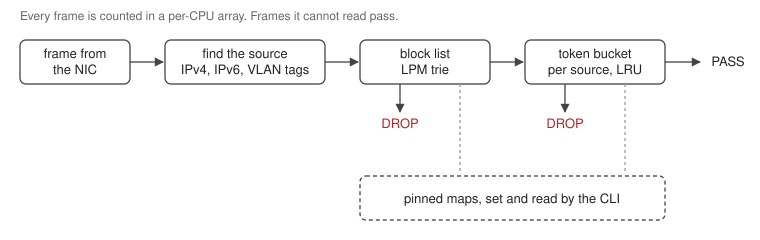

# xdp-guard

A per-source rate limiter and block list for Linux, written in Rust as an XDP program with [aya](https://aya-rs.dev).



## Try it

You need Linux 5.9 or later and root.

```sh
scripts/tools.sh                                     # nightly Rust and bpf-linker, into .tools/
make build
sudo target/release/xdp-guard attach eth0            # --mode skb if the driver has no XDP
sudo target/release/xdp-guard block 203.0.113.0/24
sudo target/release/xdp-guard limit 1000 2000        # 1000 packets a second, bursts of 2000
sudo target/release/xdp-guard stats
sudo target/release/xdp-guard detach
```

## Build and test

```sh
make check           # host tests: token bucket, frame parser, prefixes
make lint            # fmt, clippy, ShellCheck
make kernel-test     # as root: the verifier and BPF_PROG_TEST_RUN
```

CI runs all of these, and an end-to-end test in a VM. How it works and what is tested where: [docs/how-it-works.md](docs/how-it-works.md).

MIT licence; the netfilter module in `nf/` is GPL-2.0.
